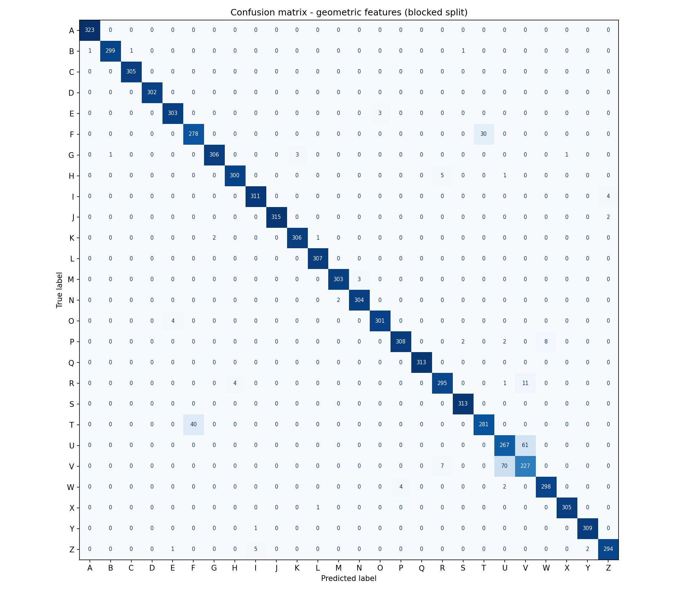

# Sign Language Translator

Real-time sign language alphabet translator using a webcam. It detects the hand with **MediaPipe**, classifies the sign with a **Random Forest**, builds words letter by letter, and reads each finished word out loud.

<!-- TODO: add a GIF or screenshot of the app running -->
<!--  -->

## Features

- Real-time recognition of the 26 letters of the <!-- TODO: ASL / LSEC / ... --> alphabet
- Letters are confirmed only after the prediction stays stable for 0.5 s, to filter out noise
- Removing your hand from the frame for 0.3 s inserts a space and ends the word
- Each finished word is spoken out loud with offline text-to-speech, in a separate thread so the camera never freezes

## How it works

```
Webcam frame → MediaPipe Hands (21 landmarks × x,y,z) → normalization + geometric features → Random Forest → letter
```

1. **Landmark extraction**: MediaPipe detects 21 hand landmarks, each with (x, y, z) coordinates, giving 63 values.
2. **Normalization**: coordinates are moved so the wrist is the origin, then scaled by the largest absolute value. This makes the prediction independent of where the hand is in the frame and how far it is from the camera.
3. **Geometric features**: 28 extra features describe how the fingers relate to each other, which raw coordinates only capture indirectly (see below). Together with the 63 normalized coordinates, each hand is described by 91 features.
4. **Classification**: a Random Forest with 500 trees predicts the letter.
5. **Text logic**: stable predictions become letters, hand absence becomes spaces, and finished words are sent to the speech queue.

Feature extraction lives in a single module, `features.py`, shared by training, evaluation and the app. This guarantees that the model receives exactly the same features in real time as during training. The app also checks at startup that the saved model expects the number of features `features.py` produces.

### Geometric features

| Group | Count | What it captures |
|---|---|---|
| Distances between every pair of fingertips | 10 | Fingers together or apart (U vs V) |
| Distances from the thumb tip to the base and middle joint of the index and middle fingers | 4 | Where the thumb is (T vs F) |
| Bending angles, two per finger | 10 | Straight vs folded fingers |
| Spread angles between neighbouring fingers | 3 | How open the hand is (U vs V) |
| Index–middle crossing value | 1 | Crossed fingers (R) |

All distances are divided by the hand size (wrist to the base of the middle finger), so they do not depend on how big the hand is. The crossing value uses the hand's own axis, so it works for both hands.

## Results

**Dataset**: 26 classes (A–Z), 8,060 samples (~310 per letter), recorded by one person.

### Why the first number was misleading

Each letter was recorded as a continuous stream of webcam frames, so consecutive samples are almost identical. Measuring the distance between samples `k` positions apart, relative to random pairs of the same letter:

| Lag (samples) | 1 | 2 | 5 | 10 | 20 | 50 | 100 |
|---|---|---|---|---|---|---|---|
| Distance ratio | 0.38 | 0.56 | 0.80 | 0.89 | 0.93 | 0.99 | 1.05 |

A ratio well below 1 means near-duplicates. With a random train/test split (or the Random Forest's out-of-bag estimate), almost every test sample has a near-identical neighbour in the training set. This is **data leakage**, and it inflates the score.

### Leakage-free evaluation

To fix it, `evaluate.py` uses **blocked 5-fold cross-validation with purging**:

- Each letter's samples are kept in recording order and cut into 5 contiguous blocks. In each fold, one block per letter is the test set.
- The 20 samples on each side of the test block are removed from training (purging), so no training sample is a direct neighbour of a test sample. The gap of 20 was chosen from the lag analysis above (ratio ≈ 0.93).

| Evaluation | Features | Accuracy | Macro F1 |
|---|---|---|---|
| Out-of-bag (Random Forest) | 63 | 99.2% | — |
| Random 5-fold CV (leaky) | 63 | 99.0% ± 0.2 | 0.990 ± 0.002 |
| Blocked 5-fold CV + purging | 63 | 94.4% ± 1.9 | 0.943 ± 0.019 |
| **Blocked 5-fold CV + purging** | **91 (+ geometric)** | **96.4% ± 1.6** | **0.964 ± 0.016** |

The leakage-free result is stable with respect to the gap size (95.0% with gap = 10, 94.4% with gap = 20, baseline features).

Both blocked experiments use exactly the same folds, so the comparison is paired: only the features change. The geometric features improve accuracy in **all 5 folds** (+1.6 to +2.6 points), which makes the improvement unlikely to be noise.

**This is still a signer-dependent, same-session estimate**: the same person, lighting and camera appear in training and test. It is an upper bound on how the model would perform with new users.

### Error analysis

With the baseline features, 22 of the 26 letters already reached an F1 above 0.95, and the errors were concentrated in two groups. The geometric features were designed for these groups:

| Letter | F1 (63 features) | F1 (91 features) | Change |
|---|---|---|---|
| T | 0.769 | 0.889 | +0.121 |
| F | 0.770 | 0.888 | +0.118 |
| U | 0.727 | 0.796 | +0.069 |
| V | 0.694 | 0.753 | +0.059 |
| R | 0.915 | 0.955 | +0.040 |

No other letter gets meaningfully worse (largest drop: H, −0.005).

- **T ↔ F** errors are halved (142 → 70): the thumb-position features work.
- **U ↔ V** errors only drop by 17% (157 → 131) and remain the main weakness.



Full per-letter reports: [baseline](results/classification_report_blocked.txt) · [geometric features](results/classification_report_blocked_features.txt). Baseline confusion matrix: [`results/confusion_matrix_blocked.png`](results/confusion_matrix_blocked.png).

## Project structure

```
├── main.py               # The translator app (camera, prediction, text and audio)
├── features.py           # Shared feature extraction: normalization + geometric features
├── training.py           # Trains the final Random Forest on the full dataset
├── evaluate.py           # Leakage-free evaluation: blocked CV, feature comparison, per-letter metrics
├── inspect_dataset.py    # Checks the dataset structure and how redundant consecutive samples are
├── coordinates.py        # Debug tool: shows the hand landmarks and their coordinates live
├── model/
│   └── modelo_senas.pkl  # Trained model (91 features)
├── dataset_landmarks/    # Dataset: one folder per letter with one .npy file per frame
├── results/              # Evaluation outputs (confusion matrices, per-letter reports)
└── requirements.txt
```

## Installation

Requires **Python 3.11** and a webcam.

```bash
git clone https://github.com/MateoNeiraCastillo/SignLanguageTranslator.git
cd SignLanguageTranslator

python -m venv .venv
source .venv/bin/activate        # Windows: .venv\Scripts\activate

pip install -r requirements.txt
```

## Usage

```bash
python main.py
```

The camera window opens directly. Start signing.

| Key | Action |
|-----|--------|
| `t` | Resume translating |
| `s` | Pause translating |
| `q` | Quit |

Tips:
- Hold each letter steady for about half a second until it appears.
- To finish a word, take your hand out of the frame. The word will be read out loud.
- Everything runs offline. Text-to-speech uses the system voice: a persistent `NSSpeechSynthesizer` on macOS (via `pyobjc`, so each word plays almost instantly) and `pyttsx3` on Windows and Linux (on Linux you may need `sudo apt install espeak`).
- On macOS, allow camera access for your terminal or IDE the first time.

## Evaluating and retraining

The dataset is included in `dataset_landmarks/`.

To evaluate the model without leakage (takes a few minutes, it trains 15 forests):

```bash
python evaluate.py
```

This prints the lag analysis, compares random and blocked cross-validation, compares the baseline and geometric features on the same folds, and saves the per-letter reports and confusion matrices to `results/`.

To train the final model used by the app:

```bash
python training.py
```

This trains the Random Forest on the full dataset with the 91 features and saves it to `model/modelo_senas.pkl`. The out-of-bag accuracy it prints is optimistic because of the leakage explained above; use `evaluate.py` for the real estimate.

## Limitations

- Only static letters: signs with movement (such as J and Z) are learned as a single hand pose. Their high scores reflect that pose, not the real movement.
- One hand at a time.
- The dataset was recorded by one person in one setting, so the 96.4% does not measure performance on other people, lighting or camera angles.
- U and V are still the most confused letters.

## Roadmap

- [x] Leakage-free evaluation: blocked cross-validation with purging, per-letter metrics and confusion matrix
- [x] Geometric features (fingertip distances, angles, finger crossing): 94.4% → 96.4%, T/F errors halved
- [ ] Recording script with signer and session metadata
- [ ] Multi-signer dataset and signer-independent evaluation (leave-one-signer-out)
- [ ] Temporal modeling (sequence models such as GRU/LSTM) to recognize signs with movement and full words
- [ ] Web deployment so it can be tried without installing anything

## Tech stack

Python · OpenCV · MediaPipe · scikit-learn · NumPy · Matplotlib · pyttsx3